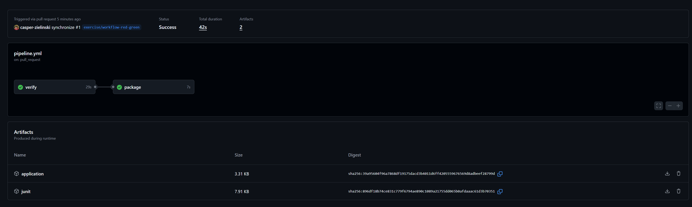
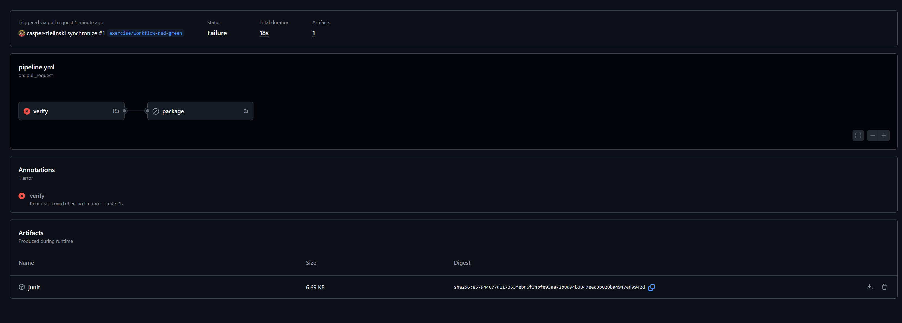

# CI/CD Pipeline Exercise

## Failed Runs

- [First failed Pipeline Run](https://github.com/casper-zielinski/CI-CD-Pipeline-with-Java-Example/actions/runs/42805663852)
- [Run failed with dependent Job](https://github.com/casper-zielinski/CI-CD-Pipeline-with-Java-Example/actions/runs/42807704186)

### 

Dependent on Verify Run: 

- [Run succeeds](https://github.com/casper-zielinski/CI-CD-Pipeline-with-Java-Example/actions/runs/42806834020)

- [Run fails](https://github.com/casper-zielinski/CI-CD-Pipeline-with-Java-Example/actions/runs/42807704186)

